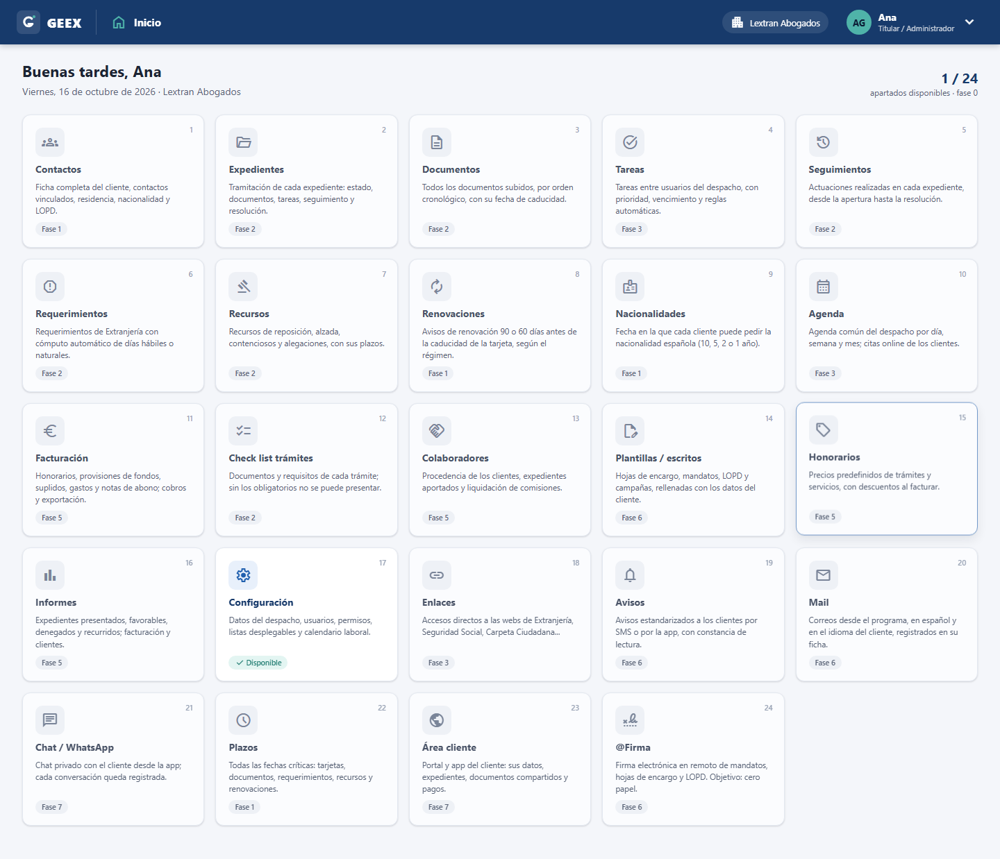
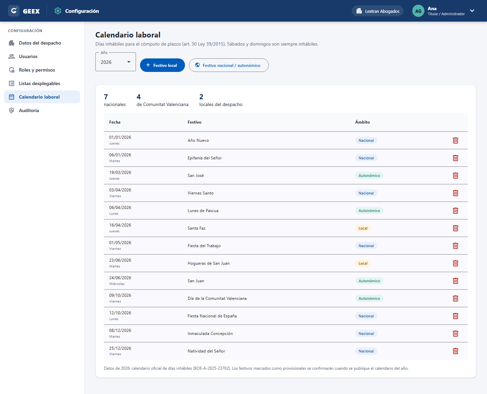
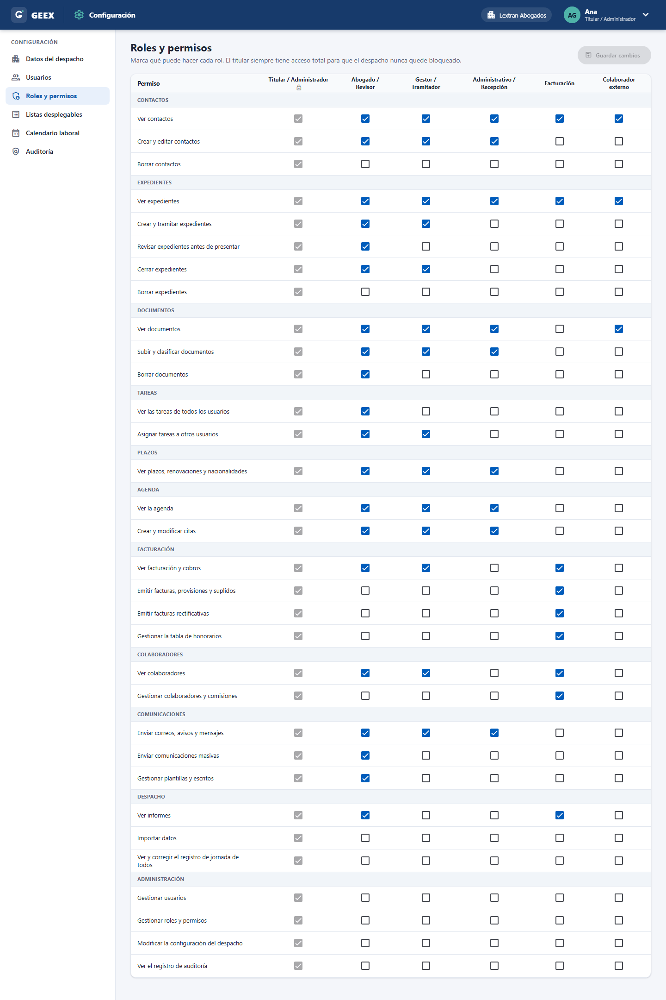
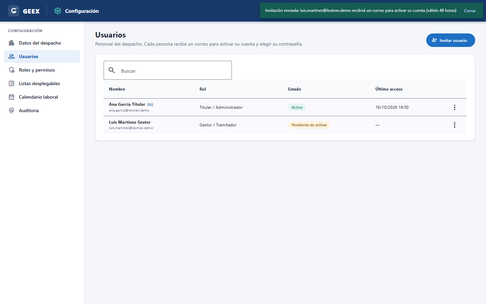
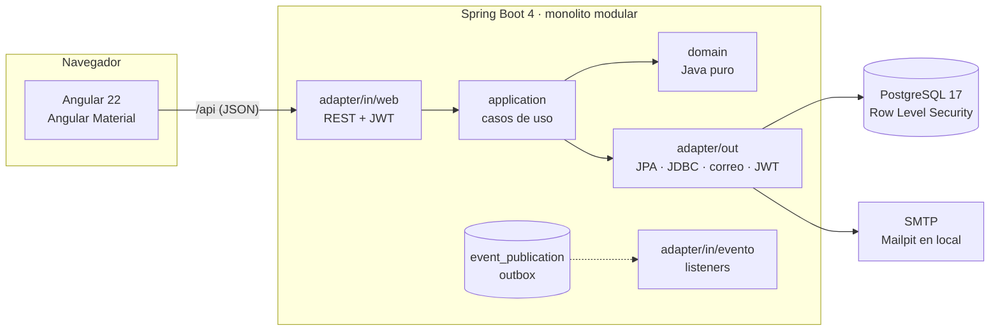

# GEEX — case management for Spanish immigration law firms

> 🇪🇸 *GEEX (Gestión de Expedientes de Extranjería) es una aplicación para gestorías y despachos de
> extranjería: clientes, expedientes, plazos, renovaciones de residencia, nacionalidad, facturación y
> portal del cliente. La interfaz está íntegramente en español.*

GEEX is a multi-tenant web application for *gestorías* that help foreigners regularise their
situation in Spain. It is built from a 60-page requirements document written by a working
immigration law firm. Deadlines are its core: a missed residence-card renewal leaves a client without
legal status, so dates, business-day calculations and alerts drive the design.

The project is being built in phases. **Phase 0 (foundations) is complete**; see the [roadmap](#roadmap).

| | |
|---|---|
|  |  |
|  |  |

## Highlights

- **Hexagonal architecture in a modular monolith.**
  - Each business module has a framework-free `domain`, plain-Java use cases and technology adapters.
  - ArchUnit and Spring Modulith tests fail the build if the rules are broken
    ([ADR 0001](docs/adr/0001-modular-monolith-hexagonal.md)).
- **Multi-tenant from day one.**
  - Every row belongs to a *despacho* (tenant).
  - PostgreSQL **Row Level Security** isolates tenants even if application code forgets a filter,
    and an integration test proves it ([ADR 0002](docs/adr/0002-multi-tenancy-row-level-security.md)).
- **Security-first authentication** ([ADR 0003](docs/adr/0003-authentication-jwt-refresh-rotation.md)):
  - stateless JWT, refresh-token rotation with reuse detection
  - Argon2id, account lockout, rate limiting
  - single-use e-mailed links
  - concurrency-tested
- **Contract-first frontend.** The Angular client is generated from the backend's OpenAPI
  specification, and a snapshot test fails the build if they drift
  ([ADR 0005](docs/adr/0005-frontend-angular-material-openapi.md)).
- **Spanish legal domain, modelled precisely:**
  - non-working-day calendars for the State, all 19 autonomous communities and local holidays,
    from the official 2026 BOE resolution
  - every dropdown from the requirements document, editable per firm
- **Event-driven, append-only audit log.** Modulith's transactional outbox guarantees no audit
  event is lost.
- **No secrets in the repository.** Secrets are generated locally by `scripts/setup`, and three
  layers (pre-commit hook, CI and GitHub push protection) catch leaks.

## Tech stack

| Layer | Technology |
|---|---|
| Backend | Java 25 · Spring Boot 4.1 · Spring Security (OAuth2 Resource Server, JWT) · Spring Data JPA + JDBC · Spring Modulith 2.1 · Flyway · springdoc-openapi |
| Database | PostgreSQL 17 (+ pgvector, prepared for the AI phase) with Row Level Security |
| Frontend | Angular 22 · Angular Material 3 · TypeScript (strict) · RxJS + signals · client generated with OpenAPI Generator |
| Testing | JUnit 5 · AssertJ · Testcontainers · ArchUnit · Spring Modulith tests · Vitest · Playwright end-to-end tests in CI (planned, Phase 1) |
| Quality & security | GitHub Actions · CodeQL · gitleaks · Dependabot · dependency review · JaCoCo |
| Delivery | Docker multi-stage images (non-root) · GitHub Container Registry · Docker Compose |

## Architecture



Backend modules (`backend/src/main/java/es/geex/`):

| Module | Responsibility |
|---|---|
| `compartido` | Shared kernel: IDs, roles, permissions, execution context (`ScopedValue`), tenant-aware `DataSource`, transactional use-case proxies, error handling (RFC 9457) |
| `identidad` | Users, login, JWT, refresh-token rotation, invitations, password reset, roles & permissions |
| `despacho` | The firm (tenant) and its details |
| `configuracion` | Configurable dropdown lists (18 lists from the requirements document, 244 nationalities) |
| `calendario` | National, regional and local non-working days (base of every deadline computation) |
| `auditoria` | Append-only activity log, fed by domain events |

More detail in the [architecture decision records](docs/adr/) and the
[requirements traceability](docs/REQUISITOS.md) (in Spanish).

## Running locally

**Requirements:** Docker Desktop, Java 25, Node.js 22. Maven is not needed (the Maven wrapper is included).

```bash
# 1. Generate the local .env with random secrets (never committed)
powershell -ExecutionPolicy Bypass -File scripts/setup.ps1   # Windows
./scripts/setup.sh                                            # Linux / macOS

# 2. Start PostgreSQL and Mailpit
docker compose up -d

# 3. Backend  → http://localhost:8080  (API docs: /swagger-ui.html)
cd backend && ./mvnw spring-boot:run

# 4. Frontend → http://localhost:4200
cd frontend && npm ci && npm start
```

On first visit GEEX opens the **installation wizard**: it creates your firm and the owner account.
E-mails sent by the application (invitations, password resets) appear in **Mailpit** at
http://localhost:8025.

### Running a published version (no build needed)

```bash
./scripts/setup.sh   # or setup.ps1
docker compose -f docker-compose.prod.yml up -d   # → http://localhost:8081
```

## Tests

```bash
cd backend && ./mvnw verify          # unit, architecture, integration (Testcontainers), concurrency
cd frontend && npm test -- --watch=false && npm run lint
```

The integration tests run the whole application against a real PostgreSQL started by Testcontainers. They cover:
- **tenant isolation:** at the API level and directly in the database
- **concurrency:** simultaneous refreshes with one token, and simultaneous installations
- **security:** lockout, rate limiting, link reuse, session revocation
- **contract:** the OpenAPI snapshot still matches the API

## CI/CD

| Workflow | When | What |
|---|---|---|
| Backend CI | every PR and push | `./mvnw verify` with Testcontainers, coverage report |
| Frontend CI | every PR and push | generate API client, lint, unit tests, production build |
| Seguridad | every PR, push and weekly | gitleaks over the full history, dependency review |
| CodeQL | every PR, push and weekly | static analysis of Java and TypeScript |
| Publicación | push to `main`, tags `v*` | builds and publishes Docker images to GHCR; GitHub Release for tags |

Branches: `main` (protected, PRs only) ← `develop` ← `feature/*`. All third-party actions are pinned to commit SHAs.

## Roadmap

| Phase | Content | Status |
|---|---|---|
| 0 | Foundations: installation, authentication, users, roles & permissions, dropdown lists, working-day calendar, audit log, CI/CD | ✅ |
| 1 | Contacts and deadline engine: client file, linked relatives, residence & nationality dates, renewals, deadlines | ⬜ |
| 2 | Case files: statuses, checklists per procedure, documents with expiry, follow-ups, requirements, appeals | ⬜ |
| 3 | Tasks with automatic workflow rules, shared agenda | ⬜ |
| 4 | Data import (Excel/CSV mapping wizard, document folders) | ⬜ |
| 5 | Invoicing (Verifactu-ready), payments, collaborators' commissions, reports | ⬜ |
| 6 | Communications: e-mail, Word templates, campaigns with consent, e-signature | ⬜ |
| 7 | Client portal: documents, chat, Stripe payments, online appointments | ⬜ |
| 8 | SaaS & extras: subscriptions, mobile app, calendar sync, time tracking, AWS (Terraform) | ⬜ |
| 9 | AI legal assistant for staff (RAG over Spanish immigration law) | ⬜ |

## Data sources and attribution

- 2026 non-working days: *Resolución de 18 de noviembre de 2025* (BOE-A-2025-23702), via the
  open dataset [plazos-extranjeria-es](https://github.com/luisdues/plazos-extranjeria-es) (MIT).
- Alicante local holidays: Ayuntamiento de Alicante, *calendario laboral 2026*.

## Licence

Copyright © 2026. All rights reserved. The source is published for portfolio and evaluation purposes.
